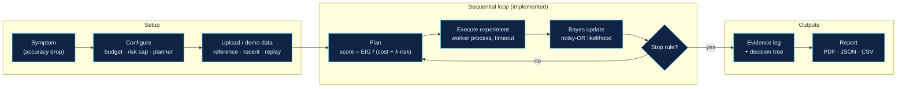
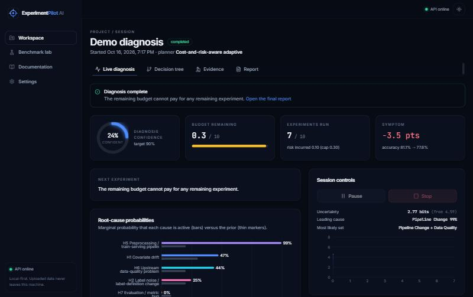
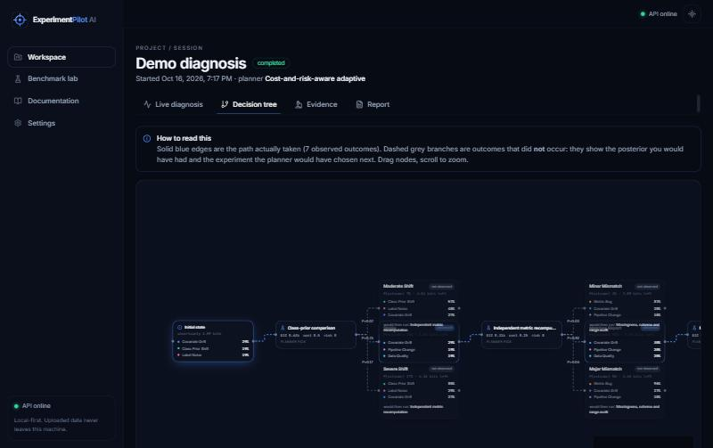
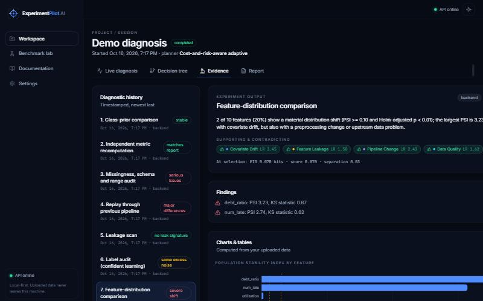
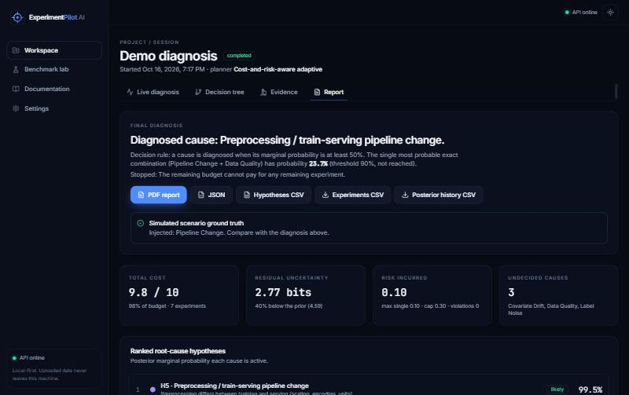
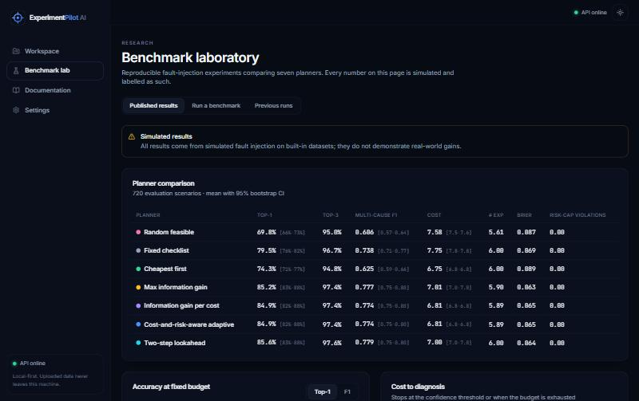
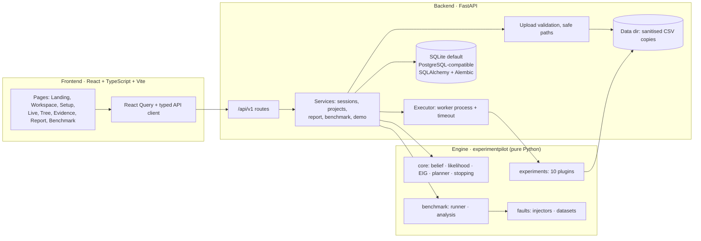
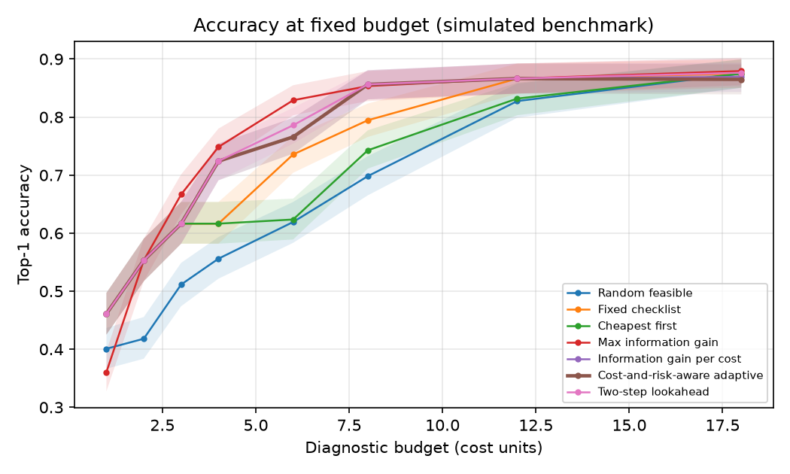

<div align="center">



**Your model broke. Which test should you run next?**
ExperimentPilot AI chooses the next diagnostic experiment — the cheapest, safest test expected to best separate the competing explanations — and updates its beliefs from real measurements on your data.


[Overview](#overview) · [Lifecycle](#experiment-lifecycle) · [Product tour](#product-tour) · [Features](#features-and-status) · [Architecture](#architecture) · [Reproducibility](#reproducibility) · [Results](#benchmark-results-simulated) · [Setup](#setup-and-usage) · [Roadmap](#roadmap)

</div>

> **Research status.** Adaptive and sequential diagnosis is an established field; this project does not claim to be the first, nor that any publication is guaranteed. Likelihood tables and every benchmark number are **simulated** (fault injection on built-in datasets). Outputs are statistical indicators, not proof of causation. See [Limitations](#limitations-and-security).

## Overview

When a deployed model degrades, teams usually work through a static checklist. ExperimentPilot treats diagnosis as a **sequential decision problem**:

1. keep a joint probability distribution over eight candidate root causes (several can be active at once);
2. pick the feasible experiment with the best `EIG / (cost + λ·risk)` under budget, risk-cap, prerequisite and approval constraints;
3. run it on a copy of your data in a time-limited worker process — or let you run it and enter the outcome;
4. update beliefs with Bayes' rule (noisy-OR likelihoods; no outcome is ever treated as certain);
5. stop when confident, out of budget, out of useful experiments, or blocked by the safety cap — then write a ranked report with residual uncertainty.

| Candidate causes (8) | Diagnostic experiments (10) | Planners (7) |
|---|---|---|
| covariate drift · label noise · feature leakage · class-prior shift · pipeline change · upstream data quality · metric/evaluation bug · model/code regression* | feature drift, data-quality audit, class prior, label noise, leakage scan, pipeline replay, importance-weighted eval, slice analysis, retrain on recent (needs approval), metric recompute | random, fixed checklist, cheapest-first, max-EIG, EIG-per-cost, cost-and-risk-aware adaptive, two-step lookahead |

<sub>*The model/code-regression hypothesis exists, but no implemented experiment discriminates it.</sub>

## Experiment lifecycle



Stopping rules: confidence ≥ τ, no feasible experiment, budget insufficient, expected value below ε, or safety-blocked.

## Product tour

Authentic screenshots of the running application (a simulated "pipeline change" fault injected into a built-in synthetic dataset; the injected ground truth is shown on the report so the diagnosis can be checked).

<table>
<tr>
<td width="50%"><br><sub><b>Live diagnosis</b> — confidence, budget, risk and per-cause marginal probabilities; run, skip, pause or stop.</sub></td>
<td width="50%"><br><sub><b>Decision tree</b> — the path actually taken (solid) and the branches that did not occur (dashed), with the experiment the planner would have chosen next.</sub></td>
</tr>
<tr>
<td><br><sub><b>Evidence explorer</b> — each outcome, findings, supporting/contradicting likelihood ratios, charts from your data.</sub></td>
<td><br><sub><b>Report</b> — ranked causes, residual uncertainty, cost and risk accounting; PDF / JSON / CSV export.</sub></td>
</tr>
<tr>
<td colspan="2"><br><sub><b>Benchmark lab</b> — published simulated results, plus the ability to launch new benchmark runs. Every number on this page is labelled simulated.</sub></td>
</tr>
</table>

## Features and status

| Feature | What it does | Status |
|---|---|---|
| Bayesian belief engine | Joint distribution over cause subsets (exact, or truncated to ≤ m simultaneous causes); soft/missing evidence; history | Implemented, tested |
| Information-based planning | EIG, separation score, plain-language rationale and rejection reasons per experiment | Implemented, tested |
| 7 planner variants | Baselines and information-based planners for comparison | Implemented, benchmarked |
| 10 real experiments | Computed on uploaded CSVs; unavailable (never faked) when inputs are missing | Implemented, tested |
| Human-in-the-loop | Planner recommends, you run the check and enter the outcome | Implemented |
| Safe execution | Process-isolated, time-limited runs; duplicate-run prevention via unique index + lock; approval gating | Implemented, tested |
| Explainability | Evidence log, decision tree, per-hypothesis supporting/contradicting evidence | Implemented |
| Reports | Ranked diagnosis, residual uncertainty, cost/risk, limitations; PDF / JSON / CSV | Implemented |
| Fault-injection benchmark | 7 planners, bootstrap CIs, paired Wilcoxon tests, calibration, robustness | Implemented; results simulated |
| Authentication, rate limiting, container sandboxing | – | **Not provided** |
| LLM-agent baseline, knapsack/Thompson planners, online likelihood refinement, real-world case study | – | **Planned** |

## Architecture



| Component | Path | Responsibility |
|---|---|---|
| Research engine | `engine/experimentpilot` | Math core, experiments, fault injectors, likelihood estimation, benchmark. No web or DB dependency |
| API | `backend/app` | Validation, persistence, orchestration, exports (`routes.py`, `services/`, `reports/`, `security/`) |
| Frontend | `frontend/src` | Presentation only; every number comes from the API |
| Research assets | `research/` | Benchmark config, runner, analysis script, published results and plots |

**One diagnostic step** (`POST /api/v1/sessions/{id}/run`): take the per-session lock → verify state and feasibility (budget, risk, inputs, approval) → insert a `running` run guarded by a partial unique index → execute in a worker process → Bayes update → stopping rules → return run, session and the next recommendation. Details and sequence diagram: [docs/architecture.md](docs/architecture.md).

**Persistence:** `projects`, `datasets` (metadata; files under `EP_DATA_DIR/projects/<id>/`), `diagnosis_sessions`, `experiment_runs`, `belief_snapshots` (posterior history), `reports`, `benchmark_jobs`. Migrations in `backend/alembic`.

**API** (interactive docs at `/api/docs` when `EP_EXPOSE_DOCS=true`; reference in [docs/api.md](docs/api.md)): `/projects` and `/projects/{id}/datasets`, `PUT /projects/{id}/mapping`, `POST /demo`, `/sessions` (create, `next`, `run`, `external`, `skip`, `pause`, `resume`, `stop`, `evidence`, `posterior-history`, `tree`, `report`, `export/*`), `/benchmarks` (published results, runs, traces, plots, exports), `/meta/*`, `/health`.

## Reproducibility

What is implemented:

- **Configuration as data** — benchmarks are defined by `research/configs/default.json` (name `default-v1`: datasets, seeds, severities, budgets, bootstrap size, planner seed `12345`).
- **Seeded scenarios** — every simulated scenario is `(dataset, injected faults, seed)`. Likelihood tables are estimated from *estimation* seeds (0–11) and planners are scored on *disjoint evaluation* seeds (100–107), including one real dataset (`breast_cancer`) never used for estimation.
- **Versioned artefacts** — `research/results/` keeps the estimated tables (`likelihood_default-v1.json`), per-scenario outcomes (`*.jsonl`), per-run CSV, summary JSON and plots from the same run.
- **Run provenance in the app** — each experiment run stores its outcome, raw statistics and selection-time scores; every belief update is stored as a snapshot, so a session's posterior history can be replayed and exported (CSV/JSON/PDF).
- **Tested** — the engine test-suite includes benchmark reproducibility checks.

Not claimed: bit-for-bit determinism across machines or library versions. Python dependencies are floored in `pyproject.toml`, **not locked** (only `frontend/package-lock.json` is). Dataset versioning for *uploaded* data is not implemented.

## Benchmark results (simulated)

720 evaluation scenarios, 3 datasets, budget 8, confidence threshold τ = 0.9 (from `research/results/results_default-v1.json`). Everything here comes from simulated fault injection.

| Planner | Top-1 | Multi-cause F1 | Mean cost |
|---|---|---|---|
| Random feasible | 0.698 | 0.606 | 7.58 |
| Fixed checklist | 0.795 | 0.738 | 7.75 |
| Cheapest first | 0.743 | 0.625 | 6.75 |
| Max information gain | 0.852 | 0.777 | 7.01 |
| Information gain per cost | 0.849 | 0.774 | 6.81 |
| Cost-and-risk-aware adaptive | 0.849 | 0.774 | 6.81 |
| Two-step lookahead | 0.856 | 0.779 | 7.00 |

<div align="center">

</div>

**Honest reading**

- Information-based planners beat random, checklist and cheapest-first at budget 8 (paired Wilcoxon p &lt; 1e-4). The curves converge at large budgets.
- The cost-and-risk-aware planner and EIG-per-cost produced **identical sequences** here; the risk term never changed a decision, and no planner violated the risk cap. Do not read them as different algorithms, or the safety benefit as demonstrated, on this evidence.
- Max-EIG and two-step lookahead are statistically indistinguishable from the adaptive planner on accuracy.
- Calibration (adaptive): ECE 0.042, Brier 0.065. Experiment thresholds were tuned while inspecting estimation scenarios and injectors/experiments were written together, so detection is likely optimistic. No real-world gain is claimed.

More plots (`cost_to_diagnosis`, `reliability`, `robustness`) are in `research/results/plots/`; protocol and threats to validity in [docs/evaluation.md](docs/evaluation.md).

## Technology stack

| Layer | Verified from the manifests |
|---|---|
| Frontend | React 18, TypeScript, Vite, Tailwind CSS, React Router, TanStack Query, Recharts, React Flow (`@xyflow/react`), Framer Motion, lucide-react |
| Backend | FastAPI, Uvicorn, Pydantic v2 / pydantic-settings, SQLAlchemy 2, Alembic, ReportLab (PDF) |
| Engine / ML | NumPy, SciPy, pandas, scikit-learn, Matplotlib |
| Storage | SQLite by default; PostgreSQL-compatible via `EP_DATABASE_URL` |
| Testing | pytest, Vitest + Testing Library, Playwright (Chromium e2e), Ruff (error-class checks) |
| Delivery | Docker / Compose and GitHub Actions workflow — **written, not verified** |

## Project structure

```
.
├── engine/                      research package (pip install -e engine)
│   ├── experimentpilot/{core,experiments,faults,likelihood,benchmark}
│   └── tests/
├── backend/
│   ├── app/{api,core,models,schemas,services,reports,security}   main.py = entry point, api/routes.py = endpoints
│   ├── alembic/                 migrations
│   └── tests/
├── frontend/
│   ├── src/{pages,components,charts,decision-tree,api,hooks,types,test}
│   └── e2e/flow.spec.ts         Playwright end-to-end
├── research/{benchmark,analysis,configs,results}
├── docs/                        methodology, architecture, API, evaluation, security, datasets, model card, assets, screenshots
├── scripts/{dev.sh,dev.ps1}
├── .github/workflows/ci.yml
└── docker-compose.yml, .env.example, BUILD_STATUS.md
```

## Setup and usage

Requirements: Python 3.11+, Node 20+.

```bash
python -m venv .venv
source .venv/bin/activate              # Windows: .venv\Scripts\Activate.ps1
pip install -e engine -e "backend[dev]"

cd backend && python -m uvicorn app.main:app --port 8000     # API + /api/docs
cd frontend && npm install && npm run dev                      # UI on http://localhost:5173
```

Or run `scripts/dev.sh` / `scripts/dev.ps1`. The database is created and migrated on first start (SQLite under `backend/data/`). Configuration: copy `.env.example` to `backend/.env` — variables `EP_DATABASE_URL`, `EP_DATA_DIR`, `EP_MAX_UPLOAD_MB`, `EP_MAX_ROWS`, `EP_MAX_COLUMNS`, `EP_CORS_ORIGINS`, `EP_EXECUTOR`, `EP_EXPERIMENT_TIMEOUT_S`, `EP_BENCHMARK_WORKERS`, `EP_ENVIRONMENT`, `EP_EXPOSE_DOCS` (all optional). No secrets are required.

**Example workflow:** *Workspace → Demo scenario →* pick a dataset and fault → *Configure diagnosis → Start diagnosis →* **Run recommended** a few times → inspect *Decision tree*, *Evidence*, *Report* and download the PDF.

**Your own data:** three UTF-8 CSVs per project (≤ 25 MB each by default): *reference*, *recent*, optional *replay*. Map target / prediction / timestamp / identifier; model files are never loaded.

**Reproduce the benchmark**

```bash
python research/benchmark/run_benchmark.py --config research/configs/default.json --workers 6   # ~1 h on 8 cores
python research/benchmark/run_benchmark.py --quick                                              # smoke run
python research/analysis/summarize.py research/results/results_default-v1.json
```

**Tests**

```bash
cd engine   && pytest -q          # 67 passed (last run)
cd backend  && pytest -q          # 32 passed (last run)
cd frontend && npm test           # 21 passed (last run)
cd frontend && npx playwright install chromium && npm run e2e    # needs both servers running
```

Docker: `docker compose up --build` (UI on `http://localhost:8080`) — written but **untested**. Outcomes of the full build are logged in [BUILD_STATUS.md](BUILD_STATUS.md).

## Limitations and security

- Likelihoods come from simulated faults on two synthetic datasets and one small real dataset; real faults can look different. Outcomes are assumed conditionally independent, and several experiments confound one another.
- No LLM baseline, no real-world case study, no online refinement of the tables.
- **No authentication — intended for trusted local use.** Present: upload size/row/column limits, content validation, safe CSV parsing, path-traversal protection, no unpickling or execution of uploads, process-isolated time-limited experiments, restricted CORS, parameterised SQL, CSV-injection-safe exports, deletion controls. Missing: rate limiting, container sandboxing. Keep uploaded data and `backend/.env` out of version control. Details: [docs/security.md](docs/security.md).

## Roadmap

| Done | Planned (not implemented) |
|---|---|
| Belief engine, 7 planners, 10 experiments, safe executor, UI, reports, simulated benchmark | Authentication and rate limiting |
| | Experiment discriminating model/code regression |
| | Knapsack and Thompson planners; LLM-agent baseline |
| | Online refinement of likelihood tables; real-world case study |
| | Locked Python dependencies; dataset versioning for uploads |
| | Verified Docker images and CI run |

## License

Not yet chosen.

## Author

**Ruchira Chowdary** — final-year B.Tech (AI & ML) project · GitHub [@ruchirachowdary-1836](https://github.com/ruchirachowdary-1836) · [Repository](https://github.com/ruchirachowdary-1836/EXPERIMENTPILOT-AI)
