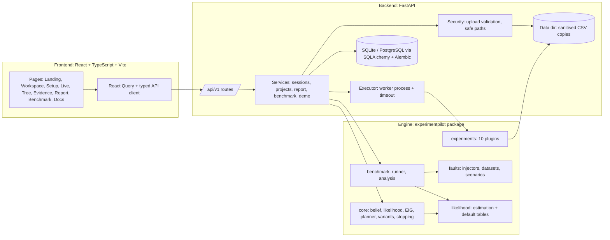
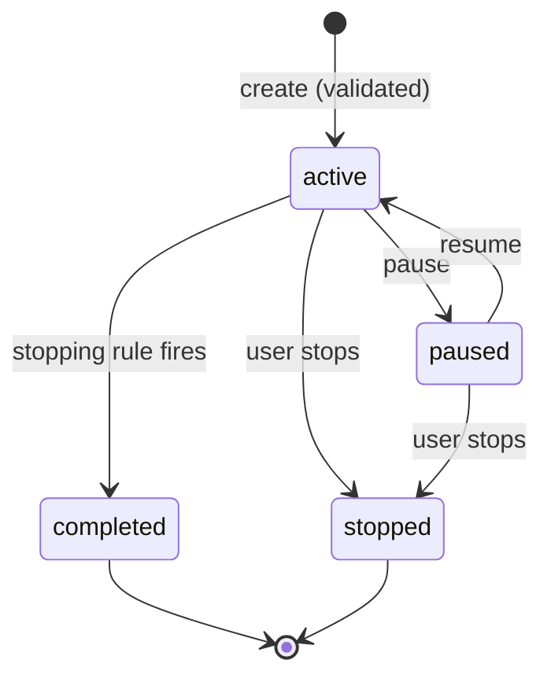
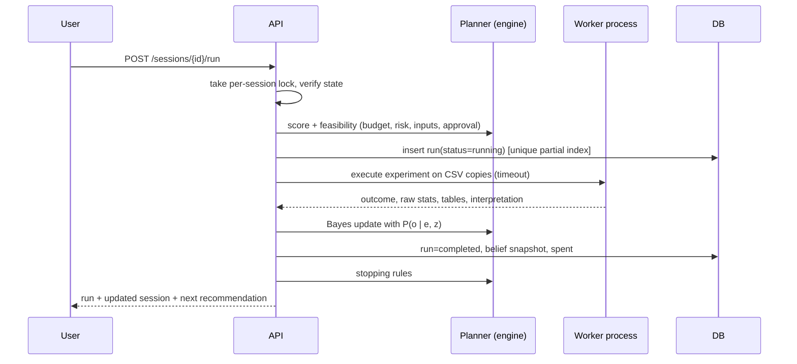

# Architecture

## Layers

| Layer | Path | Responsibility |
|---|---|---|
| Research engine | `engine/experimentpilot` | Pure-Python, independently testable, no web or DB dependency |
| API | `backend/app` | Validation, persistence, orchestration, exports |
| Frontend | `frontend/src` | Presentation only; every number comes from the API |
| Research assets | `research/` | Benchmark configs, scripts, results, analysis |

## Session lifecycle

Transitions are explicit (`TRANSITIONS` in `services/sessions.py`); invalid ones return `409`.

## One diagnostic step

### Preventing duplicate execution

1. A **partial unique index** on `(session_id, experiment_id)` for statuses `running | completed | external` means two concurrent requests cannot both create a live run; the loser gets `409`.
2. A per-session in-process lock serialises reservation and result application.
3. Only one experiment may be `running` per session.
4. Failed runs do not hold the unique slot and are not charged.

## Persistence

`projects`, `datasets` (metadata only; files live under `EP_DATA_DIR/projects/<id>/`), `diagnosis_sessions` (config, priors, current joint belief), `experiment_runs` (outcome, raw stats, tables, selection-time scores), `belief_snapshots` (posterior history), `reports` (export metadata), `benchmark_jobs`. Migrations: `backend/alembic`. SQLite for local use; set `EP_DATABASE_URL` to a PostgreSQL URL for deployment (the partial unique index has a PostgreSQL variant).

## Frontend structure

`pages/` (routes), `features`-style folders for `charts/`, `decision-tree/`, `components/` (design system), `api/` (client), `types/`, `hooks/`, `test/`.
